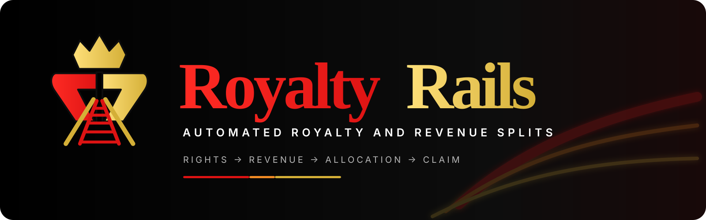

<p align="center">
  
</p>

# RoyaltyRails

**Programmable rights and royalty settlement on Solana.**

> Agree once. Get paid automatically.

RoyaltyRails turns approved revenue-sharing agreements into deterministic revenue allocations and independently claimable USDC payouts. It is designed for music royalties first, with a generic settlement core that can later support other creator and revenue-sharing workflows.

## Status

**Devnet deployed / Phase 3E — Protocol Identity & Metadata (in progress).**

Phase 3D was completed and merged in [PR #9](https://github.com/gwapupward-hub/RoyaltyRails/pull/9). The Solana devnet program has finalized deployment and two 16-participant E2E lifecycle runs with independently recorded on-chain verification evidence. See [Phase 3D](docs/PHASE_3D.md) and the [devnet deployment record](docs/DEPLOYMENT_DEVNET_V1.md).

The official public identity is **RoyaltyRails Protocol**, while the stable deployed technical name remains `royaltyrail`. [Phase 3E](docs/PHASE_3E.md) prepares public program metadata and an independently discoverable IDL; canonical on-chain publication is not yet complete.

**Not audited or mainnet-ready.** Do not use this deployment to custody or settle real customer royalties.

## Scope of this repository

This repository holds two things:

- **The RoyaltyRails Protocol**: the Solana program (`programs/`), the core accounting crate (`crates/`), the TypeScript reference packages (`packages/`), the specifications (`docs/`, `spec/`), and the devnet deployment records (`deployments/`, `docs/evidence/`).
- **SoundReceipt** (`apps/soundreceipt/`, [`docs/SOUNDRECEIPT_V1_PRD.md`](docs/SOUNDRECEIPT_V1_PRD.md)): a draft product built on the protocol. SoundReceipt is **non-production** and is **outside the protocol's security-audit scope**. Its presence here does not make it part of the protocol, and no protocol guarantee extends to it.

See the [documentation index](docs/README.md) for every document and its status.

## Hardened V1 direction

- Solana
- Native USDC settlement
- Percentage-based revenue pools
- 100,000,000-share-unit accounting
- 1–16 participants
- Unanimous participant approval
- Replacement versions require consent from both old and new participant sets
- Immutable economic terms per version
- Participant-controlled payout-wallet rotation
- Revenue allocation separated from token claiming
- Permissionless Royalty Inbox allocation
- Permissionless per-participant claims
- One broken/frozen recipient cannot block other recipients
- Canonical deployment-scoped agreement/allocation commitments
- Deterministic human-readable Agreement Manifest
- No admin withdrawal or payout override path
- Governance/guardian pause separation
- 0% protocol settlement fee in the **currently deployed devnet v1**. The approved future Phase 3F design proposes **Basic 0.25%** and **Premium Security 1.00%** fees, which are **not yet implemented**.

## Why allocate then claim?

A push-only multi-recipient transaction creates a shared failure domain: one missing or frozen recipient token account can make the whole transaction fail.

RoyaltyRails instead performs:

```text
USDC arrives
   ↓
Revenue allocated by approved percentages
   ↓
Each participant has independent claimable USDC
   ↓
Anyone may trigger that participant's claim
```

RoyaltyRails Studio/keepers can push claims automatically, preserving the normal user experience while keeping protocol liveness isolated per recipient.

## Participant security model

Economic terms and payout routing are intentionally separate.

A participant's authority, percentage and role are part of immutable agreement economics. The payout wallet is that participant's own routing state and may be rotated without group approval.

A manager cannot remove an existing participant in a replacement agreement without that participant consenting to supersession.

## Specification

- [`docs/ACCOUNTING_V1.md`](docs/ACCOUNTING_V1.md) — pure canonical allocation math
- [`docs/PROTOCOL_V1.md`](docs/PROTOCOL_V1.md) — Solana accounts/instructions/allocation/claim specification
- [`docs/STATE_MACHINE_V1.md`](docs/STATE_MACHINE_V1.md) — agreement, supersession, allocation and claim lifecycle
- [`docs/SECURITY_V1.md`](docs/SECURITY_V1.md) — trust boundaries, threat model and mainnet gate
- [`docs/ACCOUNT_LAYOUT_V1.md`](docs/ACCOUNT_LAYOUT_V1.md) — serialization and size bounds
- [`docs/AGREEMENT_MANIFEST_V1.md`](docs/AGREEMENT_MANIFEST_V1.md) — deterministic human-readable agreement representation
- [`docs/INTEGRATION_UX_V1.md`](docs/INTEGRATION_UX_V1.md) — adoption, SDK, fee sponsorship, keepers and operational UX
- [`docs/PREMERGE_AUDIT_V1.md`](docs/PREMERGE_AUDIT_V1.md) — findings that hardened the v1 design

## Brand system

The official RoyaltyRails visual identity, logo usage rules, repository-safe display assets, and implementation tokens live in [`docs/brand/`](docs/brand/README.md).

Canonical colors:

- Royalty Red — `#DD1313`
- Royal Gold — `#D4AF37`
- Accent Orange — `#F08A24`
- Background Black — `#000000`
- Surface Charcoal — `#0D0D0D`

## Engineering sequence

1. ✅ Reference allocation engine and protocol specification
2. ✅ Anchor program and settlement execution
3. ✅ Phase 3D — deterministic build, local validator, adversarial tests, devnet deployment
4. **Phase 3E — protocol identity, metadata and public verification (current)**
5. Phase 3F — on-chain two-tier protocol fee engine and treasury, including security verification
6. Phase 4 — SDK, integrations and RoyaltyRails Studio
7. Independent security audit and legal architecture review before mainnet
8. Controlled mainnet beta, subject to separate approval

## Brand vs protocol naming

The public-facing product brand is **RoyaltyRails** and the official protocol name is **RoyaltyRails Protocol**. Existing deployed v1 package names, Anchor namespace and technical identifiers that use the singular **RoyaltyRail** / `royaltyrail` remain unchanged to preserve compatibility. The canonical public devnet identity is recorded in [`deployments/devnet/protocol-identity.json`](deployments/devnet/protocol-identity.json).

## Integration philosophy

RoyaltyRails should be useful without requiring integrators to trust RoyaltyRails' hosted backend.

Canonical SDK helpers should cover:

- address derivation
- Agreement Manifest canonicalization/hashing
- agreement hashing
- approval/supersession flows
- direct funding
- inbox allocation
- participant claiming
- payout-wallet rotation
- allocation commitment verification
- reconciliation references

A third party should be able to independently verify every economic result from public protocol state and the published reference implementation.

## Music-industry interoperability

RoyaltyRails is being designed so richer music metadata and future DDEX adapters live above the small settlement core. The protocol handles approved executable payment instructions; it does not pretend to adjudicate unresolved rights claims.

## Privacy

V1 is public-chain infrastructure. Participant authorities, percentages, allocations, claims and token flows are publicly observable.

RoyaltyRails does not claim confidential royalty splits in v1.

## Safety

No contract, address, API or economic output in this repository should be treated as production settlement infrastructure until explicit security, legal, deployment and mainnet-readiness gates are complete.

## Security reports

Report vulnerabilities privately to **thagwapspot@gmail.com**. See the [RoyaltyRails security disclosure policy](SECURITY.md). The current deployment is devnet-only and has **not received an independent smart-contract security audit**. Never send private keys or recovery phrases in email.

## License

License and contribution policy will be finalized before public production release.
