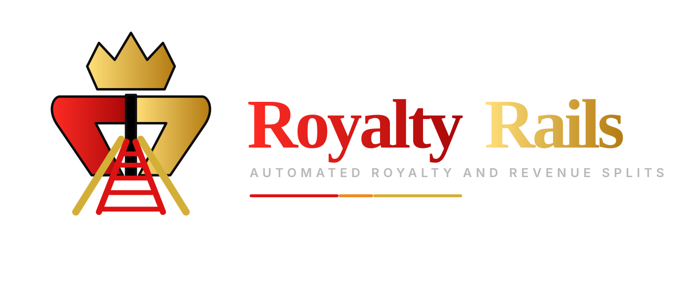

# RoyaltyRails Brand Kit

Official repository-facing visual identity for **RoyaltyRails**.

> **Automated royalty and revenue splits.**

  

## Canonical palette

| Token | Hex | Role |
|---|---|---|
| Primary Red | `#DD1313` | Core brand color, emphasis, active states |
| Royal Gold | `#D4AF37` | Premium / royalty accent |
| Accent Orange | `#F08A24` | Motion, highlights, secondary accents |
| Background Black | `#000000` | Primary background |
| Surface Charcoal | `#0D0D0D` | Cards, panels, UI surfaces |
| Primary Light | `#FFFFFF` | High-contrast text |
| Secondary Muted | `#B8B8B8` | Muted UI / supporting text |

## Typography

- **Playfair Display** — brand/display typography
- **Inter** — UI, body, and supporting text

Font files are intentionally not committed. Install them through the product font pipeline.

## Repository assets

| File | Intended use |
|---|---|
| `assets/royaltyrails-primary.svg` | Primary repository lockup |
| `assets/royaltyrails-icon.svg` | Compact monogram / product mark |
| `assets/royaltyrails-wordmark.svg` | Horizontal wordmark |
| `assets/royaltyrails-banner.svg` | README / docs banner |
| `brand-tokens.css` | CSS variables |
| `brand-tokens.json` | Machine-readable tokens |
| `BRAND_GUIDELINES.md` | Usage rules |

### Master artwork

The approved high-resolution brand kit is maintained separately as raster master artwork. The SVGs in this repository are lightweight, repository-safe display derivatives built from the locked color system and visual direction; they are **not** a replacement for a commissioned production vector master.

## Naming

**RoyaltyRails** is the approved public-facing brand. Existing v1 protocol package names and identifiers that use **RoyaltyRail** remain unchanged during protocol hardening to avoid compatibility churn.
